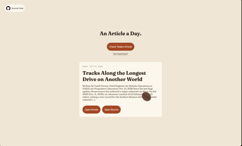

<div align="center">

# Article of The Day

[AOTD](https://article.visott.com)




[](#)
[](#)
[](#)

</div>

---

AOTD is a random article generator. It utilizes RSS Feeds to select an article each day. But, if you don't like the article you get, you can always re-roll! Read one article a day. Improve your reading skills!

AOTD is inspired by other daily sites like Word of the Day.

AOTD was made to try to reduce the friction of forming a reading habit. Reading one article a day is easier than trying to commit to reading a whole book.

## Features

- Randomly fetch an article from a bunch of sources
- Open Article Link
- Open Source Link
- Topic Selectors (General, Tech, Sports...)

## Tech Stack & How AOTD Works

AOTD (Aritcle of the Day) uses vanilla HTML, CSS, and Javascript.

A random source is selected from an array of sources using Math.random(). This source is in the same category as the category that the user selects (by default it is the "all" category).

Then, the RSS Parser library in Javascript extracts the title and description of the articles from that source. The info of one article is displayed on your screen!

AOTD is hosted using vercel.

## How to run the project yourself!

1. Clone the project

```sh
 git clone https://github.com/VITNT/Article-of-The-Day.git
```

2. Install rss-parser and other dependencies

```sh
npm install
```

3. Start the local dev server

```sh
npx vercel dev
```

4. Open the website at\*

```
http://localhost:3000
```

<sub>\*Note, the dev server may be different for you. Check your terminal after step 3 to find the dev server.</sub>

## Demo (Quick Start)

[Click Here](https://article.visott.com)
