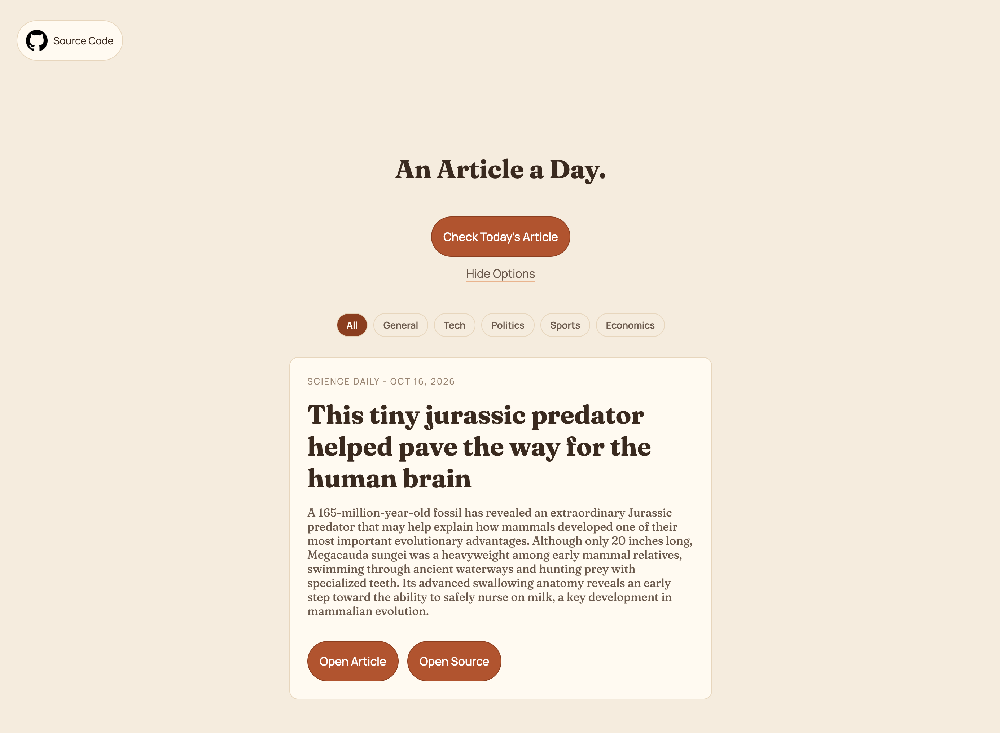

<div align="center">

# Article of The Day



[](#)
[](#)
[](#)

</div>

## About

- Read one article a day.
- Improve your reading skills!
- Keep up with the news.

## Features

- Randomly Generate an Article
- Open Article Link
- Open Source Link
- Topic Selectors (General, Tech, Sports...)

## Tech Stack

- HTML
- CSS
- JS (rss-parser)

## Architecture

```
├── README.md
├── api
│   └── article.js
├── images
│   ├── coffee-bean.png
│   ├── demo-img.png
│   ├── favicon.png
│   └── github-logo.png
├── index.html
├── package-lock.json
├── package.json
├── script.js
└── styles.css
```

## Getting Started

- Clone the demo: `git clone https://github.com/VITNT/Article-of-The-Day.git`
- Install rss-parser and other dependencies: `npm install`
- Start the local dev server: `npx vercel dev`
- Open the website at `http://localhost:3000`

## Demo

[Click Here](https://article.visott.com)
